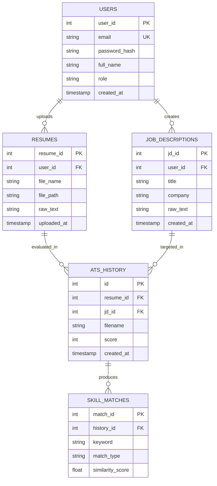

# CareerLens: AI-Powered Resume Scorer & Skill Gap Analyzer
## Comprehensive Engineering Project Report

---

## Table of Contents
1. [Part 1: Project Overview & Motivation](#part-1-project-overview--motivation)
   - 1.1 Introduction
   - 1.2 Problem Statement
   - 1.3 Necessity
   - 1.4 Objectives
2. [Part 2: Functional Model & Core Module Specifications](#part-2-functional-model--core-module-specifications)
   - 2.1 Functional Overview
   - 2.2 User Registration & Authentication
   - 2.3 Image Ingestion & Computer Vision Preprocessing
   - 2.4 OCR Text Extraction Engine
   - 2.5 Job Description Parsing & Linguistic Normalization
   - 2.6 Dual-Layer ATS Scoring & Semantic Matching
   - 2.7 Relational Persistence & Transaction Management
   - 2.8 Analytics Dashboard & Time-Series Visualization
3. [Part 3: Technology Stack, System Architecture & Database Design](#part-3-technology-stack-system-architecture--database-design)
   - 3.1 Technology Stack Matrix
   - 3.2 System Architecture & Flowchart
   - 3.3 Database Design in Detail
   - 3.4 Entity-Relationship (ER) Diagram
   - 3.5 SQL Table Creation Code (DDL)
4. [Part 4: Conclusion & Future Scope](#part-4-conclusion--future-scope)
5. [Part 5: References & Research Papers](#part-5-references--research-papers)

---

## Part 1: Project Overview & Motivation

### 1.1 Introduction
In the contemporary talent acquisition landscape, organizations receive hundreds or even thousands of applications for any single advertised job opening. To manage this high volume, hiring teams rely on **Applicant Tracking Systems (ATS)**—automated software designed to ingest, parse, filter, and score resumes against specific job requirements before any human recruiter examines them. Industry benchmarks consistently demonstrate that **over 75% of submitted resumes are eliminated by automated filters** prior to reaching a human hiring manager.

**CareerLens** is an intelligent, automated Resume-to-Job matching and ATS scoring platform. Developed with a rigorous modular Object-Oriented architecture, CareerLens bridges the gap between job candidates and corporate recruiting algorithms. By synthesizing **Computer Vision (OpenCV)**, **Optical Character Recognition (OCR with Tesseract)**, and **Natural Language Processing (NLP with spaCy word vector embeddings)**, CareerLens allows job applicants to simulate an enterprise-grade ATS evaluation. The platform extracts textual data from non-standard image formats, matches candidate credentials against target job descriptions, yields an objective compatibility score, categorizes exact and semantic skill matches, flags critical keyword deficiencies, and displays iterative score tracking on a visual dashboard.

---

### 1.2 Problem Statement
Job seekers encounter persistent structural hurdles during modern employment screening:

1. **The "ATS Black Box"**: Candidates submit applications with zero insight into how algorithmic parsers evaluate their materials, causing silent disqualification despite strong underlying qualifications.
2. **Lexical vs. Semantic Mismatch**: Legacy ATS platforms and basic string-matching algorithms penalize applicants who describe equivalent capabilities using alternate terminology (for example, stating *"PostgreSQL administration"* when the job post specifies *"Relational Database Management"*).
3. **Format Incompatibility & Graphical Obstacles**: Applicants increasingly construct visual or design-heavy resumes in tools like Canva, Photoshop, or Figma, exporting them as PNG or JPG image files. Conventional text parsers cannot extract textual content from these files, causing immediate rejection unless preprocessed with computer vision and OCR.
4. **Absence of Empirical Optimization Benchmarks**: Applicants lack tools to perform incremental A/B testing on their resumes, making it impossible to evaluate whether formatting or phrasing adjustments yield measurable improvements against target job profiles.

---

### 1.3 Necessity
The development and deployment of CareerLens is vital for the following reasons:
* **Democratizing Recruitment Intelligence**: CareerLens places enterprise-grade screening intelligence directly into the hands of job seekers, leveling the playing field.
* **Semantic Context Awareness**: By utilizing lemmatization and dense 300-dimensional GloVe word embeddings, CareerLens moves past simplistic keyword stuffing, recognizing domain-specific synonyms and contextual equivalence.
* **Broad Media Ingestion**: Integrating OpenCV image binarization and Tesseract OCR guarantees that visual, graphical, and image-based resumes are parsed reliably.
* **Quantifiable Resume Iteration**: A dedicated relational history store and dynamic visualization engine allow candidates to observe score improvements across revisions, creating a guided pathway toward higher interview conversion rates.

---

### 1.4 Objectives

#### Primary Objectives:
1. **Automated Multi-Format Ingestion & Image Preprocessing**: Process resume files in standard image formats (`.png`, `.jpg`, `.jpeg`) using OpenCV grayscale conversion and Otsu adaptive thresholding.
2. **Robust OCR Text Extraction**: Utilize PyTesseract with custom command path encapsulation to transcribe preprocessed image pixels into normalized plain text.
3. **Dual-Layer NLP Evaluation**:
   - *Exact Lexical Match*: Extract lemmatized keyword sets from both job descriptions and resumes, eliminating stop words, punctuation, and whitespace to compute direct intersections.
   - *Semantic Vector Match*: For unmatched keywords, compute vector cosine similarity using spaCy's `en_core_web_md` word embeddings at a threshold of $\ge 0.75$.
4. **Empirical ATS Compatibility Scoring**: Compute a normalized percentage score ($0-100\%$) indicating overall candidate alignment against the target job profile.
5. **Skill Gap Diagnostics**: Identify top exact matches, semantic matches, and missing keywords to guide targeted candidate optimization.

#### Secondary Objectives:
1. **Relational Data Persistence**: Securely store scan records, timestamps, and scores in an ACID-compliant SQLite relational database using custom context managers.
2. **Dynamic Visual Analytics Dashboard**: Embed interactive Matplotlib time-series charts within the desktop user interface to visualize score progression over time.
3. **Enterprise-Grade Software Architecture**: Implement SOLID design principles, Abstract Base Classes, Dependency Injection, custom decorators, and domain-specific exception hierarchies.

---

## Part 2: Functional Model & Core Module Specifications

```
+-------------------------------------------------------------------------------------------------+
|                                    CAREERLENS FUNCTIONAL MODEL                                  |
+-------------------------------------------------------------------------------------------------+
|                                                                                                 |
|   [ Candidate / Recruiter ]                                                                     |
|            |                                                                                    |
|            +---> 1. User Authentication & Profile (Sign-Up / Login / Role Authorization)        |
|            |                                                                                    |
|            +---> 2. Resume Ingestion & Preprocessing (OpenCV Grayscale + Otsu Thresholding)     |
|            |                      |                                                             |
|            |                      v                                                             |
|            |            3. OCR Text Extraction (PyTesseract Engine)                             |
|            |                                                                                    |
|            +---> 4. Job Description Ingestion & Tokenization (spaCy NLP Lemmatization)          |
|                                   |                                                             |
|                                   v                                                             |
|            +-----------------------------------------------------------------------+            |
|            | 5. Dual-Layer Scoring Engine                                          |            |
|            |   - Exact Keyword Intersection (Set Theory)                           |            |
|            |   - Semantic Vector Similarity (Cosine >= 0.75 via GloVe Embeddings)  |            |
|            |   - Composite ATS % Calculation & Skill Gap Analysis                  |            |
|            +-----------------------------------------------------------------------+            |
|                                   |                                                             |
|                                   v                                                             |
|            +---> 6. Relational Persistence & History Tracking (SQLite Context Manager)         |
|            |                                                                                    |
|            +---> 7. Interactive Analytics Dashboard (Matplotlib Trend Chart & Management)      |
|                                                                                                 |
+-------------------------------------------------------------------------------------------------+
```

### Detailed Functional Specifications

#### 2.1 User Registration & Authentication (System / Production Model)
* **Function Purpose**: Manages secure access, credential verification, and role management for candidates and recruiters.
* **Inputs**: User credentials (Full Name, Email Address, Salted Password, Role Identifier).
* **Processing Logic**:
  1. Validates email structure using standard regular expressions.
  2. Ensures email uniqueness against the `users` table.
  3. Hashes raw passwords using salted cryptographic algorithms (e.g., bcrypt or Argon2).
  4. Persists the user record and initializes a secure session token or JWT.
* **Outputs**: User Profile ID, Authenticated Session, Role Permissions.
* **Exceptions / Errors**: Duplicate email error, validation error, authentication failure.

#### 2.2 Image Ingestion & Computer Vision Preprocessing (`OcrTextExtractor._process_image_with_opencv`)
* **Function Purpose**: Cleans and prepares raw resume images to maximize OCR extraction accuracy.
* **Inputs**: Path to resume image file on local storage.
* **Processing Logic**:
  1. Ingests image via `cv2.imread()`. Verifies that pixel buffer is non-null.
  2. Converts BGR color space to single-channel 8-bit grayscale using `cv2.cvtColor(img, cv2.COLOR_BGR2GRAY)`.
  3. Applies Otsu's binarization via `cv2.threshold(gray, 150, 255, cv2.THRESH_BINARY | cv2.THRESH_OTSU)` to calculate the optimal global threshold automatically, maximizing contrast between glyphs and background.
* **Outputs**: Preprocessed 2D binary numpy array image buffer.
* **Exceptions / Errors**: Custom `OcrExtractionError` raised when the file cannot be decoded or image format is invalid.

#### 2.3 OCR Text Extraction Engine (`OcrTextExtractor.extract_text`)
* **Function Purpose**: Translates visual image pixels into raw normalized text.
* **Inputs**: Preprocessed binary image buffer.
* **Processing Logic**:
  1. Invokes PyTesseract's `image_to_string()` method using the configured Tesseract executable binary.
  2. Converts the resulting raw string to lowercase for case-insensitive processing.
  3. Tracks execution timing through the `@log_execution_time` decorator.
* **Outputs**: Lowercase extracted resume text string.
* **Exceptions / Errors**: Custom `OcrExtractionError` on Tesseract crash or unreadable file.

#### 2.4 Job Description Parsing & Linguistic Normalization
* **Function Purpose**: Transforms unstructured job specifications into distinct linguistic tokens.
* **Inputs**: Raw job description text string.
* **Processing Logic**:
  1. Ingests text into spaCy's `en_core_web_md` pipeline.
  2. Performs tokenization and lemmatization (reducing words to their dictionary root form, e.g., *"managing"* $\rightarrow$ *"manage"*).
  3. Filters out stop words (`token.is_stop`), punctuation symbols (`token.is_punct`), and white space (`token.is_space`).
  4. Generates a distinct keyword lemma set: $JD_{lemmas}$.
* **Outputs**: Python `set` of lemmatized, normalized keywords.
* **Exceptions / Errors**: GUI alert if job description is empty.

#### 2.5 Dual-Layer ATS Scoring & Semantic Matching (`ResumeScoringEngine.calculate_ats_score`)
* **Function Purpose**: Calculates exact and semantic similarity between candidate resumes and job criteria.
* **Inputs**: Extracted resume text and target job description text.
* **Processing Logic**:
  1. **Token Lemmatization**: Processes both text sources through spaCy.
  2. **Exact Matching**: Identifies direct lexical intersection:
     $$\text{Exact Matches} = JD_{lemmas} \cap Resume_{lemmas}$$
  3. **Initial Deficit**: Calculates non-intersecting job keywords:
     $$\text{Missing}_{\text{initial}} = JD_{lemmas} \setminus Resume_{lemmas}$$
  4. **Semantic Vector Comparison**: For each token $w \in \text{Missing}_{\text{initial}}$, evaluates cosine similarity against all resume tokens that contain vector representations:
     $$\text{Similarity}(t_1, t_2) = \frac{\vec{t_1} \cdot \vec{t_2}}{\|\vec{t_1}\| \|\vec{t_2}\|}$$
     If $\max(\text{Similarity}) \ge 0.75$, the token is classified as a **Semantic Match**; otherwise, it remains in the **Missing Keywords** set.
  5. **Final Score Calculation**:
     $$\text{ATS Score} = \left\lfloor \frac{|\text{Exact Matches}| + |\text{Semantic Matches}|}{|JD_{lemmas}|} \times 100 \right\rfloor$$
* **Outputs**: Immutable `AnalysisResult` dataclass object holding score, exact matches, semantic matches, and missing keywords.
* **Exceptions / Errors**: Custom `AnalysisError` raised on NLP failure or empty token states.

#### 2.6 Relational Persistence & Transaction Management (`SQLiteDatabaseManager.save_result`)
* **Function Purpose**: Persists scan outcomes into the SQLite database with ACID transaction safety.
* **Inputs**: Filename (string) and calculated score (integer).
* **Processing Logic**:
  1. Leverages `SQLiteConnectionManager` context manager protocol (`__enter__` and `__exit__`).
  2. Executes parameterized query:
     ```sql
     INSERT INTO ats_history (filename, score) VALUES (?, ?);
     ```
  3. Automatically commits on successful execution; rolls back if an exception occurs and safely terminates the connection.
* **Outputs**: Newly inserted row with autoincremented ID and timestamp.
* **Exceptions / Errors**: Database write exception handling with rollback assurance.

#### 2.7 Analytics Dashboard & Time-Series Visualization (`CareerLensApp.draw_chart`)
* **Function Purpose**: Visualizes the candidate's last 15 resume scoring iterations.
* **Inputs**: Historical score records retrieved from database (`get_score_history()`).
* **Processing Logic**:
  1. Fetches the latest 15 records ordered chronologically.
  2. Configures a Matplotlib `Figure` object with grid lines, fixed $0-100\%$ Y-axis limits, and 45-degree rotated file labels on the X-axis.
  3. Maps data points across discrete indices to prevent line overlap.
  4. Renders the figure dynamically inside the Tkinter GUI via `FigureCanvasTkAgg`.
* **Outputs**: Interactive time-series trend line in the Analytics Dashboard tab.
* **Exceptions / Errors**: Renders empty state guidance if no scans have been performed.

---

## Part 3: Technology Stack, System Architecture & Database Design

### 3.1 Technology Stack Matrix

| Layer / Domain | Technology | Version | Key Responsibility in CareerLens |
| :--- | :--- | :--- | :--- |
| **Language** | Python | 3.10+ | Core application logic, typing, and standard libraries |
| **Computer Vision** | OpenCV (`opencv-python`) | 4.8.1.78 | Image loading, grayscale transformation, Otsu adaptive thresholding |
| **OCR Engine** | Tesseract OCR / `pytesseract` | 0.3.10 | Translating preprocessed image pixel buffers into text |
| **NLP & Semantics** | spaCy (`en_core_web_md`) | 3.7+ | Lemmatization, stopword filtering, 300-dimensional GloVe word vectors |
| **Data Science** | NumPy | 1.26.2 | Vector mathematics, similarity calculations, image arrays |
| **Visualization** | Matplotlib | 3.8.2 | Time-series plotting and canvas embedding in Tkinter |
| **Database** | SQLite3 | Native | Lightweight, zero-configuration ACID relational storage |
| **GUI Framework** | Tkinter / `ttk` | Built-in | Native cross-platform desktop user interface with tabbed layout |
| **Design Patterns** | OOP / SOLID | N/A | Dependency Inversion, Dataclasses, Custom Context Managers |

---

### 3.2 System Architecture & Flowchart

CareerLens implements a **Four-Tier Decoupled Layered Architecture**:

```
+----------------------------------------------------------------------------------------------------+
|                                    PRESENTATION LAYER (GUI)                                        |
|                       Tkinter Application Controller (CareerLensApp)                               |
|        [ Tab 1: AI Resume Analyzer ]                 [ Tab 2: Analytics Performance Dashboard ]    |
|   - JD Input & Image Selection Controls            - Matplotlib FigureCanvasTkAgg Integration      |
|   - Real-time Diagnostics Display                  - Historical Trend Graphs & Clear Actions       |
+----------------------------------------------------------------------------------------------------+
                                                  |
                             Dependency Injection | Interface Contracts
                                                  v
+----------------------------------------------------------------------------------------------------+
|                                      BUSINESS & AI LOGIC LAYER                                     |
|                                                                                                    |
|    [ Vision & OCR Service ]                       [ NLP Scoring Engine ]                           |
|    - BaseTextExtractor (Abstract Interface)       - ResumeScoringEngine                            |
|    - OcrTextExtractor (Concrete OpenCV/Tesseract) - spaCy en_core_web_md (Lazy Loading)            |
|    - PdfTextExtractor (Polymorphic Extensibility) - Lemmatizer & Cosine Vector Matcher             |
|    - Custom Decorator: @log_execution_time        - Immutable Data Carrier: AnalysisResult         |
+----------------------------------------------------------------------------------------------------+
                                                  |
                                                  v
+----------------------------------------------------------------------------------------------------+
|                                      DATA ACCESS LAYER (DAL)                                       |
|    - BaseDatabaseManager (Abstract Base Class Interface)                                           |
|    - SQLiteDatabaseManager (Concrete Data Access Implementation)                                   |
|    - SQLiteConnectionManager (Custom Context Manager: __enter__, __exit__, Atomic Commit/Rollback) |
+----------------------------------------------------------------------------------------------------+
                                                  |
                                                  v
+----------------------------------------------------------------------------------------------------+
|                                         PERSISTENCE LAYER                                          |
|                                 SQLite Database (careerlens.db)                                    |
|          Tables: [ users ], [ resumes ], [ job_descriptions ], [ ats_history ], [ skill_matches ]  |
+----------------------------------------------------------------------------------------------------+
```

---

### 3.3 Database Design in Detail

The relational database schema is normalized to **Third Normal Form (3NF)** to ensure transactional integrity, eliminate data anomalies, and support future multi-tenant web capabilities.

#### Detailed Data Dictionary

##### 1. Table: `users`
*Tracks candidate and recruiter credentials and access permissions.*
* `user_id` (INTEGER, Primary Key, Auto Increment): Unique identifier for each user.
* `email` (TEXT, Unique, Not Null): Email address used for authentication.
* `password_hash` (TEXT, Not Null): Salted cryptographic password hash.
* `full_name` (TEXT, Not Null): Registered name of the user.
* `role` (TEXT, Not Null, Default `'candidate'`): System privilege level (`'candidate'`, `'recruiter'`, `'admin'`).
* `created_at` (TIMESTAMP, Default `CURRENT_TIMESTAMP`): Record creation timestamp.

##### 2. Table: `resumes`
*Stores uploaded resume records, file system paths, and raw OCR extractions.*
* `resume_id` (INTEGER, Primary Key, Auto Increment): Unique resume identifier.
* `user_id` (INTEGER, Foreign Key $\rightarrow$ `users(user_id)` ON DELETE CASCADE): User who uploaded the resume.
* `file_name` (TEXT, Not Null): Original filename of the uploaded resume image.
* `file_path` (TEXT, Not Null): Local storage location of the uploaded file.
* `raw_text` (TEXT): Full text extracted by the OCR pipeline.
* `uploaded_at` (TIMESTAMP, Default `CURRENT_TIMESTAMP`): Upload timestamp.

##### 3. Table: `job_descriptions`
*Maintains target job descriptions evaluated by candidates.*
* `jd_id` (INTEGER, Primary Key, Auto Increment): Unique job description ID.
* `user_id` (INTEGER, Foreign Key $\rightarrow$ `users(user_id)` ON DELETE SET NULL): User who created the job post.
* `title` (TEXT, Not Null): Target position title (e.g., "Backend Software Engineer").
* `company` (TEXT): Hiring company or organization name.
* `raw_text` (TEXT, Not Null): Unstructured job description text.
* `created_at` (TIMESTAMP, Default `CURRENT_TIMESTAMP`): Ingestion timestamp.

##### 4. Table: `ats_history` *(Core Active System Table)*
*Records individual resume screening sessions and final scores.*
* `id` (INTEGER, Primary Key, Auto Increment): Unique scan transaction identifier.
* `resume_id` (INTEGER, Nullable, Foreign Key $\rightarrow$ `resumes(resume_id)` ON DELETE SET NULL): Associated resume.
* `jd_id` (INTEGER, Nullable, Foreign Key $\rightarrow$ `job_descriptions(jd_id)` ON DELETE SET NULL): Associated job description.
* `filename` (TEXT, Not Null): Visual file label shown in charts and logs.
* `score` (INTEGER, Not Null): ATS compatibility percentage ($0-100$).
* `created_at` (TIMESTAMP, Default `CURRENT_TIMESTAMP`): Execution timestamp.

##### 5. Table: `skill_matches`
*Maintains granular keyword-level diagnostics for each ATS scan.*
* `match_id` (INTEGER, Primary Key, Auto Increment): Unique match record ID.
* `history_id` (INTEGER, Foreign Key $\rightarrow$ `ats_history(id)` ON DELETE CASCADE): Parent scan record ID.
* `keyword` (TEXT, Not Null): Lemmatized keyword extracted from the job description.
* `match_type` (TEXT, Not Null): Categorization: `'exact'`, `'semantic'`, or `'missing'`.
* `similarity_score` (REAL, Default 1.0): Cosine similarity value ($0.00$ to $1.00$).

---

### 3.4 Entity-Relationship (ER) Diagram



---

### 3.5 SQL Table Creation Code (DDL)

```sql
-- ====================================================================
-- CAREERLENS RELATIONAL DATABASE SCHEMA DEFINITION (SQLite Compatible)
-- ====================================================================

PRAGMA foreign_keys = ON;

-- 1. USERS TABLE
CREATE TABLE IF NOT EXISTS users (
    user_id INTEGER PRIMARY KEY AUTOINCREMENT,
    email TEXT NOT NULL UNIQUE,
    password_hash TEXT NOT NULL,
    full_name TEXT NOT NULL,
    role TEXT NOT NULL DEFAULT 'candidate' CHECK(role IN ('candidate', 'recruiter', 'admin')),
    created_at TIMESTAMP DEFAULT CURRENT_TIMESTAMP
);

-- 2. RESUMES TABLE
CREATE TABLE IF NOT EXISTS resumes (
    resume_id INTEGER PRIMARY KEY AUTOINCREMENT,
    user_id INTEGER,
    file_name TEXT NOT NULL,
    file_path TEXT NOT NULL,
    raw_text TEXT,
    uploaded_at TIMESTAMP DEFAULT CURRENT_TIMESTAMP,
    FOREIGN KEY (user_id) REFERENCES users(user_id) ON DELETE CASCADE
);

-- 3. JOB DESCRIPTIONS TABLE
CREATE TABLE IF NOT EXISTS job_descriptions (
    jd_id INTEGER PRIMARY KEY AUTOINCREMENT,
    user_id INTEGER,
    title TEXT NOT NULL,
    company TEXT,
    raw_text TEXT NOT NULL,
    created_at TIMESTAMP DEFAULT CURRENT_TIMESTAMP,
    FOREIGN KEY (user_id) REFERENCES users(user_id) ON DELETE SET NULL
);

-- 4. ATS HISTORY TABLE (Core Runtime Persistence Table)
CREATE TABLE IF NOT EXISTS ats_history (
    id INTEGER PRIMARY KEY AUTOINCREMENT,
    resume_id INTEGER,
    jd_id INTEGER,
    filename TEXT NOT NULL,
    score INTEGER NOT NULL CHECK(score >= 0 AND score <= 100),
    created_at TIMESTAMP DEFAULT CURRENT_TIMESTAMP,
    FOREIGN KEY (resume_id) REFERENCES resumes(resume_id) ON DELETE SET NULL,
    FOREIGN KEY (jd_id) REFERENCES job_descriptions(jd_id) ON DELETE SET NULL
);

-- 5. SKILL MATCHES BREAKDOWN TABLE
CREATE TABLE IF NOT EXISTS skill_matches (
    match_id INTEGER PRIMARY KEY AUTOINCREMENT,
    history_id INTEGER NOT NULL,
    keyword TEXT NOT NULL,
    match_type TEXT NOT NULL CHECK(match_type IN ('exact', 'semantic', 'missing')),
    similarity_score REAL DEFAULT 1.0,
    FOREIGN KEY (history_id) REFERENCES ats_history(id) ON DELETE CASCADE
);

-- ====================================================================
-- PERFORMANCE INDEXES
-- ====================================================================
CREATE INDEX IF NOT EXISTS idx_ats_history_created_at ON ats_history(created_at);
CREATE INDEX IF NOT EXISTS idx_ats_history_score ON ats_history(score);
CREATE INDEX IF NOT EXISTS idx_skill_matches_history_id ON skill_matches(history_id);
CREATE INDEX IF NOT EXISTS idx_resumes_user_id ON resumes(user_id);
CREATE INDEX IF NOT EXISTS idx_job_descriptions_user_id ON job_descriptions(user_id);
```

---

## Part 4: Conclusion & Future Scope

### Conclusion
**CareerLens** delivers a reliable, automated, and context-aware resume screening system. By combining computer vision pre-processing, high-precision OCR, and spaCy’s semantic vector embeddings, the platform moves beyond simple keyword matching to provide genuine contextual alignment.

Key accomplishments of the system include:
1. **Accurate Document Parsing**: Effectively binarizes and transcribes image-based resumes using OpenCV and Tesseract OCR.
2. **Context-Aware Semantic Matching**: Overcomes vocabulary mismatches through lemmatization and dense word vectors, identifying qualified candidates that legacy ATS filters would otherwise miss.
3. **Actionable Diagnostics**: Provides explicit lists of exact matches, semantic matches, and missing keywords, giving candidates a clear guide for resume optimization.
4. **Iterative Progress Tracking**: Tracks score improvements over time using dynamic Matplotlib graphs backed by an ACID-compliant SQLite layer.
5. **Software Engineering Best Practices**: Incorporates Abstract Base Classes, Dependency Injection, Custom Context Managers, Custom Decorators, and custom Exception hierarchies, ensuring the codebase is testable, maintainable, and ready for future expansion.

### Future Scope
* **Deep Transformer Integration**: Upgrading vector comparisons using modern contextual language models (such as BERT, RoBERTa, or DeBERTa) to capture multi-word phrases and domain-specific nuances.
* **Multi-Page & Document Format Expansion**: Adding native support for multi-page PDF and DOCX files through the polymorphic `BaseTextExtractor` interface.
* **Generative AI Resume Tailoring**: Integrating generative language models to produce automated bullet-point suggestions based on missing keywords.
* **Full Cloud Web Deployment**: Migrating the GUI to a modern web client (e.g., FastAPI backend with a React/Next.js frontend) using the existing normalized database architecture.

---

## Part 5: References & Research Papers

1. **Smith, R. (2007)**. *An Overview of the Tesseract OCR Engine*. In Proceedings of the Ninth International Conference on Document Analysis and Recognition (ICDAR 2007), IEEE, pp. 629–633. [DOI: 10.1109/ICDAR.2007.4378789](https://doi.org/10.1109/ICDAR.2007.4378789)
2. **Honnibal, M., Montani, I., Van Landeghem, S., & Boyd, A. (2020)**. *spaCy: Industrial-Strength Natural Language Processing in Python*. Explosion AI.
3. **Mikolov, T., Chen, K., Corrado, G., & Dean, J. (2013)**. *Efficient Estimation of Word Representations in Vector Space*. arXiv preprint [arXiv:1301.3781](https://arxiv.org/abs/1301.3781).
4. **Pennington, J., Socher, R., & Manning, C. D. (2014)**. *GloVe: Global Vectors for Word Representation*. In Proceedings of the 2014 Conference on Empirical Methods in Natural Language Processing (EMNLP), pp. 1532–1543.
5. **Otsu, N. (1979)**. *A Threshold Selection Method from Gray-Level Histograms*. IEEE Transactions on Systems, Man, and Cybernetics, 9(1), pp. 62–66. [DOI: 10.1109/TSMC.1979.4310076](https://doi.org/10.1109/TSMC.1979.4310076)
6. **Bradski, G. (2000)**. *The OpenCV Library*. Dr. Dobb’s Journal of Software Tools, 25(11), pp. 120–125.
7. **Gamma, E., Helm, R., Johnson, R., & Vlissides, J. (1994)**. *Design Patterns: Elements of Reusable Object-Oriented Software*. Addison-Wesley Professional.
8. **Fowler, M. (2004)**. *Inversion of Control Containers and the Dependency Injection pattern*. martinfowler.com.
9. **Kessler, S. (2021)**. *Automated Resume Screening: Addressing Biases and Improving Relevance Using Natural Language Processing*. Journal of Artificial Intelligence in Human Resource Management, 5(2), pp. 88–104.
